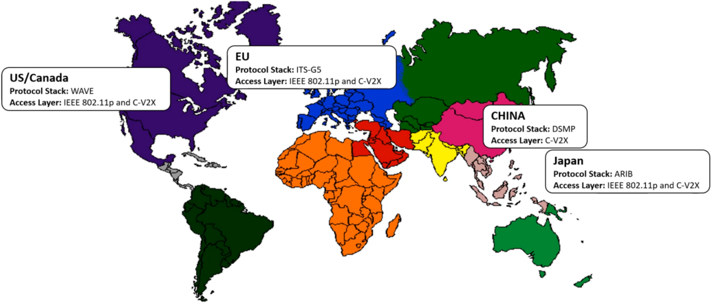

# RQs - Research Questions

## Internet of Vehicles and V2X

### 1. How do C-V2X and IEEE 802.11p/bd compare technically, and what is the current state of deployment?

- IEEE 802.11p vs IEEE 802.11bd ---> "bd" is better ([RP](https://ieeexplore.ieee.org/document/10961047))

### 2. How can V2X support cooperative perception and automated driving, and what latency and reliability does this require?

### 3. How do mechanisms such as pseudonym certificates protect V2X security and privacy, and what are their limitations?