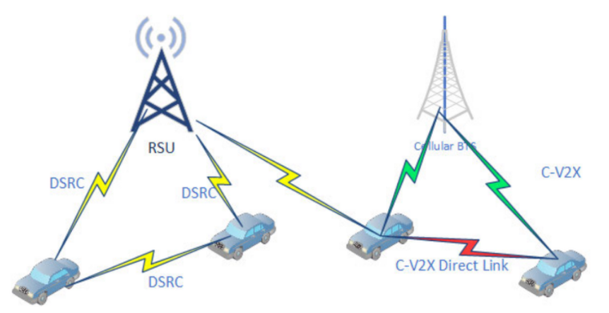
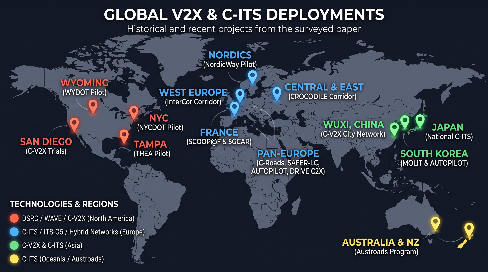
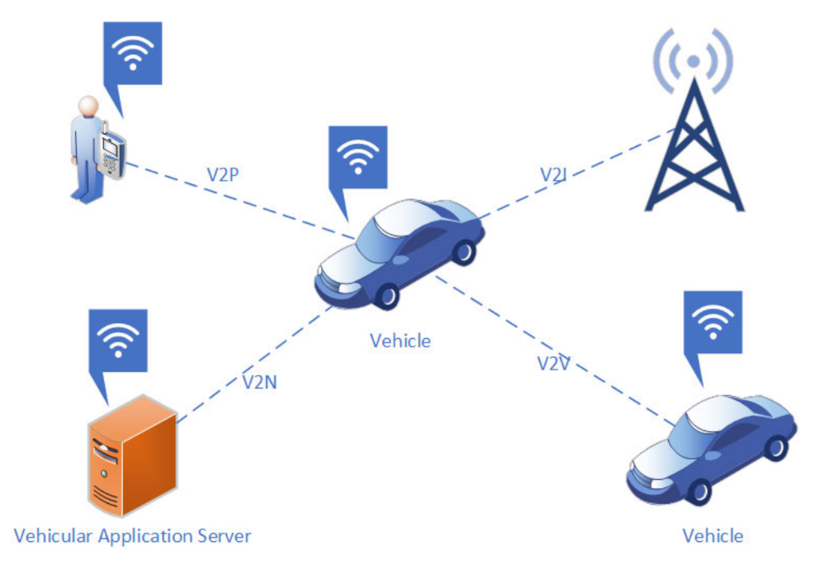

# RQs - Research Questions

## Internet of Vehicles and V2X

### 1. How do C-V2X and IEEE 802.11p/bd compare technically, and what is the current state of deployment?

####  RPs:
1. "On SDN to Support the IEEE 802.11 and C-V2X-Based Vehicular Communications Use-Cases and Performance: A Comprehensive Survey" ([accessible](https://ieeexplore.ieee.org/abstract/document/10352136))
2. "A Survey on the Use-Cases and Deployment Efforts Toward Converged Internet of Things (IoT) and Vehicle-to-Everything (V2X) Environments" ([accessible](https://acta.sze.hu/index.php/acta/article/view/627))

#### Introduction
- Vehicular communications are enabled mainly by two major RATs, one based on wifi/IEEE 802.11 family standard and the other one is cellular/C-V2X. Each RAT family has its advantages and disadvantages.
- The IEEE standardized the Wifi family (IEEE 802.11), meanwhile, the cellular family was standardized by the 3GPP.
- In the United States, the Wifi based vehicular communications technologies are called DSRC, and it is implemented as a WAVE. WAVE technology is supported by IEEE 802.11p technology as the physical layer (PHY) and datalink layer (MAC) and supported by IEEE 1609 standards for the transport, network, facilities, management, and security layers. DSRC technologies have several advantages related to low end-to-end latency, low cost, and flexibility of implementation because there is no need for a centralized control system for vehicular communications infrastructure. Meanwhile, the disadvantages of these technologies are security problems and difficulty overcoming line-of-sight problem. In Europe, the Wifi based vehicle communication standard is called cooperative-ITS (C-ITS), also known as the ITS generation 5 (ITS-G5) standard. The PHY and MAC layer of the C-ITS used the IEEE 802.11p standard as the basis and adopted the ETSI EN 302 663, which specified the C-ITS access layer standard. Meanwhile, the RAT in the cellular family currently used are LTE-V2X and 5G. Cellular technologies have advantages related to a wide coverage area, security, performance, and better scalability. However, these technologies have weaknesses related to infrastructure, which must always be managed in a centralized manner, end-to-end latency, and a higher implementation price.
- IEEE 802.11-based vehicular communications technologies appeared first because the IEEE 802.11p standard has existed since 2010, while LTE-V2X technology has only emerged as a standard in 2015-2016. From all papers discussed in this section, WiFi (IEEE 802.11) and cellular (C-V2X) are the main technologies enabling vehicular communications.

#### Problem
- Frequency spectrum scarcity in vehicular communications -> using both RAT family protocols [SDN - 38]. 
	- Using only one RAT cannot meet all communication performance requirements, such as CAM communication. The study in [36] encourages multiple RAT coexistence and interoperability on the shared 5.9GHz frequency. IEEE 802.11p is suitable for low-moderate vehicle density, while LTE-V2X excels in high vehicle density situations.
	- The research findings suggest that the coexistence of multiple RATs can address challenges in vehicular communication, such as low data rate and high latency in multi-hop V2X communication [6]. Clustering vehicles and allowing them to choose between cellular and DSRC communication based on network performance improves V2X communication QoS, reduces network load, and minimizes unnecessary handovers [6]. Additionally, the coexistence of IEEE 802.11p and LTE-V2X in the same geographical area and channel with a fixed preamble insertion helps overcome frequency spectrum scarcity. It reduces collisions, particularly in high vehicle density conditions. Using multiple RATs on the shared frequency, such as IEEE 802.11p and LTEV2X, improves performance in varying vehicle density situations [38].

#### Paper results

##### SDN - Table 2 - Performance comparison of vehicular communications RATs.
1. **[SDN - 23]** NR-V2X outperformed IEEE 802.11bd, and IEEE 802.11bd outperformed IEEE 802.11p regarding latency and data rates. IEEE 802.11bd improve the performance of IEEE 802.11p in high Doppler scenarios. The dual carrier modulation and extended range options in IEEE 802.11bd could improve cell edge performance and communication range.
2. **[SDN - 5]** The LTE-V2X communication range better than IEEE 802.11p, and LTE-V2X PDR better than IEEE 802.11p.
3. **[SDN - 21]** The safety communication performance requirements can be met by IEEE 802.11bd but not with IEEE 802.11p.
4. **[SDN - 30]** The packet drop rate of IEEE 802.16e is lower than IEEE 802.11p at various speeds. Communication throughput for IEEE 802.11p is better than IEEE 802.16e for speeds below 90 km/hour; above 90 km/hour, IEEE 802.16e is better.
5. **[SDN - 22]** PRR of IEEE 802.bd with or without DCM+RE is better than IEEE 802.11p. IEEE 802.11bd with DCM+RE extends the communication range; however, it creates channel congestion.
6. **[SDN - 25]** LTE-V2X has better performance than IEEE 802.11p in terms of beaconing frequency, vehicle mobility, and scalability.
7. **[SDN - 31]** The ability of IEEE 802.11p to support the communication of beacon messages for safety applications is better than LTE.
8. **[SDN - 32]** The IEEE 802.11bd standard has a higher throughput and lower latency than the IEEE 802.11p standard. And also packet reception ratio of IEEE 802.11bd also better than IEEE 802.11p: 88% vs 75%.
9. **[SDN - 33]** IEEE 802.11bd can fulfill QoS at the PHY, MAC, and Application layers for several safety applications that IEEE 802.11p cannot fulfill.
10. **[SDN - 34]** The UW-based PHY with low-complexity channel estimation has the same performance as high-complexity channel estimation in IEEE 802.11bd standard draft.
11. **[SDN - 35]** The IEEE 802.11bd standard performance is better than the IEEE 802.11p standard, especially in high Doppler scenarios. IEEE 802.11bd also has a better communication range than IEEE 802.11p.
12. **[SDN - 16]** The IEEE 802.11p standard can better overcome variations in message size and time intervals between messages than LTE-V2X. However, under shallow channel load conditions, the inefficiency of IEEE 802.11p is higher than that of LTE-V2X.

##### SDN - Table 3 - RAT Coexistence
1. **[SDN - 6]** The implementation of vehicle clustering and RAT selection result in better communication QoS and reduce the network load and the number of handovers.
2. **[SDN - 38]** The application of methods has successfully reduced collision between two RATs and proof the effectiveness of the proposed solution on the dense vehicle's condition.
3. **[SDN - 36]** IEEE 802.11p standard performance can meet the safety communication performance requirements in low-moderate vehicle density condition and LTE-V2X communication performance requirements in high vehicle density condition.
4. **[SDN - 39]** The application of the QR algorithm has succeeded in forming an error-prone wireless channel.
5. **[SDN - 40]** Implementing architecture and protocol stack for hybrid vehicular network RATs create fewer vertical handovers, higher reliability, and lower delays

##### States of Deployment
**European C-ITS Projects (ITS-G5 and Hybrid Networks)**

- **CROCODILE (2013):** Links road networks across 13 Central and Eastern European countries, focusing on data collection via **CCTV** (Closed-Circuit Television) and sensors to support cross-border traffic management.
- **C-ROADS (2015):** Implemented in 43 cities across 16 countries, using a hybrid **C-ITS** (Cooperative Intelligent Transport Systems) model. It transmits "Day-1-services" (early-stage deployment services like hazardous location or roadworks warnings) via **OBUs** (On-Board Units installed inside vehicles) and **RSUs** (Roadside Units installed on road infrastructure), utilizing **AMQP** (Advanced Message Queuing Protocol) for message sharing.
- **NordicWay (2015–2017):** A pilot in Denmark, Finland, Norway, and Sweden providing hazard warnings through cellular networks, paving the way for **CCAM** (Cooperative, Connected and Automated Mobility).
- **SCOOP@F (2014–2019):** A French pilot connecting 3,000 vehicles over 2,000 km of roads, evolving from Wi-Fi-based ITS-G5 to hybrid cellular communication for European interoperability.
- **SAFER-LC (2017):** A 10-country project integrating road and rail infrastructure to improve safety at level crossings.
- **AUTOPILOT (2017–2019):** A large-scale pilot across 14 European countries and South Korea focusing on automated driving use cases like autonomous car sharing and automated parking.
- **InterCor & DRIVE C2X:** InterCor linked corridors in the Netherlands, France, the UK, and Belgium for cross-border testing. DRIVE C2X established seven national test sites, proving that cooperative systems (like in-vehicle speed limit signage) successfully reduce road fatalities.

**U.S. USDOT Deployments (DSRC / WAVE)**

- **NYCDOT Connected Vehicle Pilot (2015):** Deployed 353 RSUs and 8,000 OBU-equipped vehicles in New York City to achieve "Vision Zero" safety goals using **DSRC** (Dedicated Short-Range Communications). It also integrated 100 personal mobile devices to warn pedestrians.
- **Tampa DOT Pilot (THEA) (2015):** Focused on urban congestion and collision avoidance in downtown Tampa, utilizing 47 RSUs, over 1,000 equipped vehicles, and 500 personal safety devices connected to a **TMC** (Traffic Management Center)
- **Wyoming DOT Pilot (WYDOT) (2015):** Addressed commercial vehicle safety and weather incidents along the I-80 freight corridor with 75 RSUs and 400 equipped trucks.

**Asian & Australasian Deployments**

- South Korea established a C-ITS program through **MOLIT** (Ministry of Land, Infrastructure, and Transport).
- Japan deployed C-ITS across its national highway system, and Australia and New Zealand are advancing deployments through the Austroads program.

**5G & Next-Generation C-V2X Trials**

- **5GCAR (2019):** A 14-partner European project demonstrating a 5G testbed in France for advanced maneuvers like lane-merge coordination and pedestrian protection.
- **Wuxi Internet of Vehicle (China):** Deployed a city-level C-V2X network in Wuxi.
- **United States Trials (2017):** First C-V2X connected car trials were launched in San Diego by a consortium including AT&T, Ford, Nokia, and Qualcomm.

   
   

---

---

### 2. How can V2X support cooperative perception and automated driving, and what latency and reliability does this require?

---

### 3. How do mechanisms such as pseudonym certificates protect V2X security and privacy, and what are their limitations?
