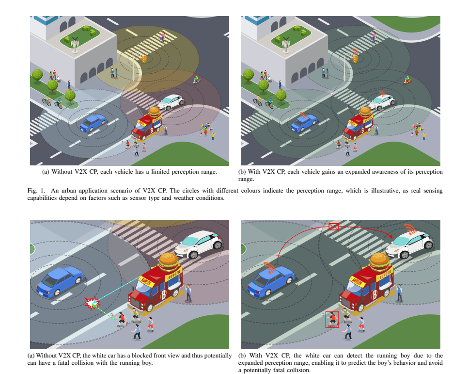
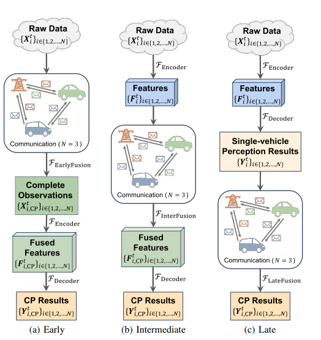
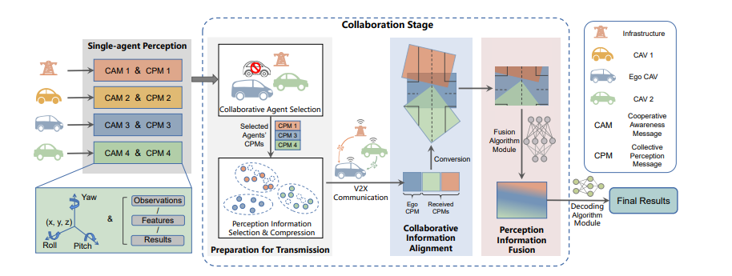
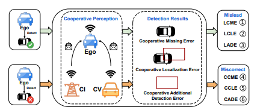
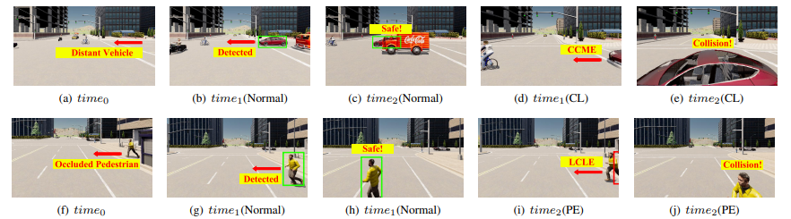
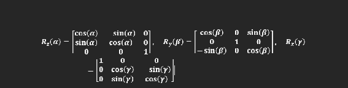

# Internet of Vehicles and V2X

## 2. How can V2X support cooperative perception and automated driving, and what latency and reliability does this require?

**Análise Aprofundada: Como o V2X Suporta a Percepção Cooperativa e a Condução Autónoma, e Quais os Requisitos de Latência e Fiabilidade**

**1\. Introdução**

**A evolução e o futuro da condução autónoma estão estritamente ligados às tecnologias de Comunicação Veículo-para-Tudo (*Vehicle-to-Everything* \- V2X). Os Veículos Autónomos (AVs) modernos dependem de uma arquitetura de perceção individual (como câmaras, LiDAR e radar) para compreender e navegar pelo seu ambiente de condução. Contudo, a perceção isolada manifesta limitações físicas incontornáveis, tais como zonas cegas causadas por oclusões (outros veículos, infraestruturas e edifícios) e alcances de deteção restritos sob condições meteorológicas adversas ou longas distâncias.** 

**Neste contexto, a Perceção Cooperativa Veicular (CP) viabilizada por redes V2X surge como o paradigma essencial para ultrapassar as fronteiras físicas do sensor individual. Ao permitir a troca dinâmica e a fusão de dados entre veículos conectados, Unidades de Beira-Estrada (*Roadside Units* \- RSUs), peões e plataformas na nuvem/edge, a perceção cooperativa transforma a tomada de decisão veicular de um modelo individualista e reativo para uma inteligência em rede distributiva, ampla e proativa.** 

**Para que o sistema de condução autónoma se comporte de forma segura, correta e previsível, a mera partilha de dados não é suficiente. Exige-se que os dados trocados satisfaçam requisitos estritos de alinhamento temporal, reduzida latência de transmissão e elevada fiabilidade (*reliability*). Dados desatualizados, incompletos ou ruidosos partilhados no ecossistema V2X podem induzir o veículo recetor em erro, provocando decisões incorretas que comprometem a segurança e podem originar acidentes de viação.** 

**1.1 Contextualização da Perceção e a Necessidade de Cooperação**

**Perceção Individual e Mecanismos de Captação**

**A perceção individual veicular assenta no processamento contínuo de dados captados pelos seus sensores de bordo:** 

* **Câmaras: Fornecem densa informação semântica, cromática e de textura (ex.: identificação de sinais de trânsito, marcações de vias e tipos de objetos).** 

* **LiDAR (*Light Detection and Ranging*): Fornece uma representação geométrica tridimensional (3D) precisa sob a forma de nuvens de pontos.** 

* **Radar (e ondas milimétricas): Mede com precisão a distância e a velocidade Doppler de objetos sob condições meteorológicas adversas.** 

**Insuficiência da Perceção Individual**

**Apesar da sofisticação destes sensores, operar de forma isolada revela fragilidades críticas em cenários urbanos dinâmicos e complexos. Fatores como a linha de vista (*Line-of-Sight* \- LOS) bloqueada por veículos de grande porte, cantos de edifícios em intersecções ou peões a emergir por trás de obstáculos impedem os sensores de bordo de detetar ameaças em tempo útil.** 

**Introdução ao V2X e Elementos Interagentes**

**A perceção cooperativa resolve o dilema LOS através da partilha de dados entre múltiplos nós da rede veicular:** 

* **V2V (*Vehicle-to-Vehicle*): Veículos partilham estados e vetores de perceção entre si.** 

* **V2I (*Vehicle-to-Infrastructure*): Intercâmbio de dados entre veículos e unidades RSU localizadas no topo de cruzamentos ou vias rápidas.** 

* **V2P (*Vehicle-to-Pedestrian*) e V2N (*Vehicle-to-Network*): Integração de utilizadores vulneráveis (peões/ciclistas) e infraestruturas em nuvem.** 

**Exemplo Ilustrativo de Aplicação da Perceção Cooperativa**

**Considere-se uma via urbana onde um veículo autónomo ("Veículo A") circule atrás de uma camioneta de entregas de grande porte parada. Entre a camioneta e o passeio, uma criança/peão atravessa a estrada em corrida.** 

* **Cenário Sem V2X: Os sensores do "Veículo A" têm a vista frontal bloqueada pela camioneta. O peão é completamente invisível (bloqueio por oclusão), impedindo que o sistema tome uma decisão atempada de travagem, culminando num atropelamento eminente.** 

* **Cenário Com V2X CP: Um "Veículo B" conectado que circula no sentido oposto ou uma câmara/LiDAR instalada numa RSU no topo da rua tem o peão no seu campo de visão desimpedido. Através da rede V2X, esse nó envia as coordenadas e trajetórias detetadas ao "Veículo A". O sistema de controlo do "Veículo A" processa essa informação expandida e desacelera antecipadamente com total segurança, evitando o acidente.** 

**1.2 Aspetos Técnicos, Fusão, Infraestrutura e Padrões de Comunicação**

**Técnicas de Fusão**

**O processamento de dados partilhados na perceção cooperativa divide-se formalmente em três arquiteturas/estratégias:** 

1. **Fusão Inicial (*Early Collaboration* / Fusão de Dados Brutos): Partilha de dados brutos obtidos diretamente dos sensores (ex.: nuvens de pontos LiDAR completas ou imagens captadas).** 

   * ***Vantagem:*** **Mantém a totalidade da fidelidade geométrica/semântica da informação.** 

   * ***Desvantagem:*** **Requer uma largura de banda extremamente elevada e estrita sincronização temporal.** 

2. **Fusão Intermédia (*Intermediate Collaboration* / Fusão de Funcionalidades): Os nós locais utilizam codificadores para extrair mapas de funcionalidades (*feature maps*) ou vetores latentes e partilham apenas essas representações comprimidas.** 

   * ***Vantagem:*** **Representa o estado da arte e o equilíbrio ideal entre precisão de perceção e consumo sustentável de largura de banda.** 

3. **Fusão Tardia (*Late Collaboration* / Fusão de Decisão): Cada agente conclui o processamento localmente e partilha apenas a lista de resultados finais (caixas delimitadoras 3D, posições, classes e trajetórias).** 

   * ***Vantagem:*** **Consumo de largura de banda extremamente reduzido.** 

   * ***Desvantagem:*** **Não permite recuperar objetos que tenham sido perdidos localmente pelos sensores individuais (*missing detections*).** 

**Mecanismos de Transmissão e Protocolos V2X (DSRC e 5G NR V2X)**

**A infraestrutura de comunicação baseia-se em duas famílias tecnológicas fundamentais:** 

* **DSRC (*Dedicated Short-Range Communications*): Baseado na norma IEEE 802.11p, opera na faixa dos 5,9 GHz com arquitetura descentralizada de baixo alcance (\< 1 km) e baixa latência.** 

* **C-V2X e 5G NR V2X: Padronizado pelo 3GPP (Release 14 a 16+ e 5G NR V2X). Atua através da interface PC5 (*Sidelink* para comunicação direta veicular de curta distância em 5,9 GHz com ultra-baixa latência) e da interface Uu (rede móvel celular via gNB/estações base e nuvem para operações de longo alcance).** 

**Suporte de Infraestrutura (Veículo-Estrada-Nuvem) e Cidades Inteligentes**

**As arquiteturas Veículo-Estrada-Nuvem (*Vehicle-Road-Cloud*) integram nós de Computação na Periferia da Rede (*Multi-access Edge Computing* \- MEC) colocados junto às RSUs. O nó MEC agrega dados veiculares e de sensores fixos em tempo real, executa tarefas intensivas de fusão regional e retransmite aos veículos circundantes um modelo de mundo semântico unificado (*Bird's-Eye-View* \- BEV).** 

**Mecanismos de Tomada de Decisão e Aprendizagem Profunda**

**A fusão e interpretação dos vetores cooperativos recorrem a arquiteturas avançadas de Inteligência Artificial:** 

* **Redes Neuronais em Grafo (GNNs): Modelam os agentes (veículos/RSUs) como nós e as ligações V2X como arestas num grafo de cooperação dinâmico.** 

* **Mecanismos de Atenção e Transformers (ex.: Vision Transformers / ViT): Mapeiam interações espácio-temporais de longo alcance em representações BEV, permitindo focar a fusão em áreas e agentes com maior relevância informativa (ex.: *V2X-ViT*, *Where2comm*, *V2VFormer*).** 

* **Detetores End-to-End e Filtros de Kalman: Combinam o processamento profundo de imagem/LiDAR com técnicas de estimação estatística e rastreio multiobjeto (ex.: *Extended/Cubature Kalman Filters*) para atualizar estados de incerteza.** 

**1.3 Latência, Fiabilidade e Padrões de Erro na CP**

**Valores de Latência Aceitáveis e Impacto de Latências Elevadas**

**Para serviços de perceção cooperativa aplicados à segurança crítica (ex.: travagem de emergência, prevenção de colisões e mudanças de via), os requisitos da indústria e normas (como 3GPP e ETSI) estipulam latências máximas fim-a-fim entre 10 ms e 100 ms com frequências de atualização de 10 Hz a 20 Hz.** 

**Em cenários reais de circulação, atrasos causados por congestionamento de rede ou perdas de pacotes degradam severamente o desempenho:** 

* **Quando a latência de transmissão excede os 100 ms a 300 ms, os mapas e vetores de dados partilhados perdem o seu alinhamento temporal e a sua precisão cai abruptamente.** 

* **Sob latências extremas (\> 500 ms), o desempenho do sistema cooperativo pode cair abaixo do desempenho do veículo operando totalmente sozinho (*Single-Agent*).** 

**Fiabilidade (*Reliability*) e Integridade dos Dados**

**A fiabilidade da informação partilhada é crucial para garantir que decisões automatizadas corretas sejam tomadas. Informação corrompida, vetores desalinhados devido a erros de pose (GPS/IMU com ruído) ou oclusões podem induzir tomadas de decisão erróneas.** 

**Padrões Formais de Erro em Sistemas de Perceção Cooperativa**

**A literatura recente de testes empíricos categoriza formalmente os erros induzidos pela perceção cooperativa quando comparados com a perceção individual do veículo ego:** 

1. **Erros Enganadores (*Misleading Cooperative Errors* \- LE): Acontecem quando a perceção individual do veículo estava correta, mas a perceção cooperativa (por fusão imperfeita ou dados incorretos) corrompe o resultado final:** 

   * **LCME (*Misleading Missing Error*): O veículo detetava o objeto sozinho, mas a cooperação faz com que o objeto desapareça do mapa final.** 

   * **LCLE (*Misleading Localization Error*): O veículo localizava o objeto com precisão, mas a cooperação desloca a caixa delimitadora 3D do objeto para uma posição incorreta.** 

   * **LADE (*Misleading Additional Detection Error*): A cooperação introduz um objeto "fantasma" num local onde na realidade não existe nenhum obstáculo.** 

2. **Erros Mal Corrigidos (*Miscorrected Cooperative Errors* \- CE): Acontecem quando a perceção individual do veículo falhava e a cooperação não consegue corrigir ou agrava essa falha:** 

   * **CCME (*Miscorrected Missing Error*): O veículo falhou a deteção individual e a cooperação continua sem conseguir detetar o objeto.** 

   * **CCLE (*Miscorrected Localization Error*): O veículo tinha uma localização imperfeita e a cooperação mantém ou piora o erro de localização do objeto.** 

   * **CADE (*Miscorrected Additional Detection Error*): O veículo criou uma deteção fantasma e a cooperação valida incorretamente esse objeto inexistente.** 

**Impacto Prático e Cenários de Acidente**

**Conforme demonstrado em testes em ambiente fechado e simulado:** 

* **Atrasos de Comunicação (CL): Geram comummente erros do tipo LCLE e CCME. *Exemplo:* Em um cruzamento, a informação de que um veículo perpendicular se aproxima chega com atraso ao veículo recetor. O módulo de planeamento pressupõe a via livre, falha na travagem e colide no meio do cruzamento.** 

* **Erros de Posicionamento/Pose (PE): O desalinhamento de GPS/IMU entre o emissor e o recetor causa desvios espaciais que provocam erros críticos do tipo LCLE. *Exemplo:* Um peão a atravessar a estrada é partilhado com um desvio lateral de 1,5 metros; o sistema calcula que o peão está seguro fora da faixa de rodagem, mantendo a velocidade até ao embate.** 

**1.4 Testes, Ferramentas e Desempenho em Ambientes de Simulação (CARLA, AWSIM, VAST)**

**A avaliação dos sistemas CP é maioritariamente efetuada através de plataformas de simulação avançadas devido aos elevados custos e perigos associados a testes reais de frota. O simulador CARLA, frequentemente integrado com o SUMO (simulador de tráfego) e ambientes de ecossistema como OpenCDA e V2Xverse, bem como simuladores como AWSIM e toolchains de validação como o VAST (*V2X/Dynamic Map-Aware Autonomous Driving Systems Validation Toolchain*), estabeleceram-se como as ferramentas padrão da indústria.** 

**Comportamento dos Veículos e Métrica sob Condições Controladas**

**Os ensaios em simulações virtuais e validações híbridas (*Hardware-in-the-Loop*) revelaram conclusões empíricas determinantes sobre o comportamento e segurança do veículo autónomo:** 

* **Modos de Cooperação vs. Módulos de Fusão: Sob condições ideais de comunicação no CARLA, o uso de redes V2X aumenta substancialmente a precisão de deteção 3D (*Average Precision* \- AP@0.5/0.7) e a Pontuação de Condução (*Driving Score* \- DS). Em fusão intermédia (modelos como *V2X-ViT*, *F-Cooper*, *DiscoNet*), a taxa de colisão descende vertiginosamente de taxas superiores a 36,8% (veículo isolado) para cerca de 26,3%.** 

* **V2V vs. V2I: O V2I (*Vehicle-to-Infrastructure*) atinge desempenhos de topo na fusão inicial (*Early Fusion*) devido à elevada resolução e posição elevada dos sensores das RSUs. Em fusão intermédia e tardia, a cooperação V2V (*Vehicle-to-Vehicle*) demonstra superioridade pela similaridade entre os pontos de vista e menor desfasamento geométrico das caraterísticas.** 

* **Comportamento do Veículo sob Interferências de Rede (Latência e Pose Error):**

  * **Quando submetidos a simulação de latência de comunicação (CL) entre 500 ms e 1000 ms, a pontuação de condução dos veículos (*Driving Score*) sofre uma queda severa (redução de até 10,3%), e a taxa de colisão aumenta de 26,3% para 42,1%.** 

  * **Quando submetidos a erros de pose (PE) entre 0,2 m a 0,6 m de desvio, a taxa de colisão aumenta igualmente para 42,1%, comprovando a extrema vulnerabilidade dos veículos autónomos a instabilidades de comunicação.** 

**1.5 Direções Futuras em Perceção Cooperativa V2X** 

**A análise da literatura científica recente destaca as seguintes linhas de investigação que visam resolver os estrangulamentos identificados:** 

1. **Sensing and Communication Integrated (ISAC \- *Integrated Sensing and Communication*): A integração no 6G das redes veiculares onde o mesmo hardware e largura de banda são utilizados concorrentemente para deteção por radar de alta resolução e transmissão de dados de alta velocidade, eliminando a interferência de espectro.** 

2. **Comunicação Semântica e Orientada à Tarefa (*Semantic & Task-Oriented V2X*): Transição da partilha de dados volumosos para a transmissão estrita do contexto semântico relevante. Em vez de enviar imagens completas, o veículo transmite apenas elementos informativos cruciais associados a objetos de risco e áreas prioritárias da via.** 

3. **Modelos de Linguagem Multimodais e Foundation Models para V2X: Aplicação de grandes modelos visuais e de linguagem (VLM / LLMs) integrados com redes V2X. O objetivo reside em permitir o raciocínio percetivo de linguagem natural e análise causal de cenários de risco ("por que razão aquele peão pode atravessar") combinando mapas BEV cooperativos em tempo real.** 

4. **Validação Híbrida e Toolchains Abertas (ex.: VAST): Metodologias de validação *Beyond Line-of-Sight* que integram o software real do veículo (como Autoware) com co-simulações de rede e mapas dinâmicos em cenários urbanos complexos.**

5. **Perceção Resiliente ao Erro e Aprendizagem Federada Mantenedora de Privacidade (*Privacy-Preserving Federated Learning*): Implementação de mecanismos adaptativos em tempo real capazes de recalibrar a incerteza percetiva e treinar modelos distribuídos em múltiplos veículos e RSUs sem necessidade de partilhar dados brutos privados dos utilizadores.** 

**1.6 Lista Completa de Referências Bibliográficas (6 Artigos)**

* **\[Ref-1 / arXiv:2310.03525v5\] T. Huang, J. Liu, X. Zhou, D. C. Nguyen, M. R. Azghadi, Y. Xia, Q.-L. Han, e S. Sun, "Vehicle-to-Everything Cooperative Perception for Autonomous Driving," *Proceedings of the IEEE*, vol. 113, 2025\.** 

* **\[Ref-2 / arXiv:2509.24927v1\] A. Guo, S. Zhang, E. Tang, X. Gao, H. Pang, H. Tian, Y. Mu, W. Wen, C. Fang, e Z. Chen, "When Autonomous Vehicle Meets V2X Cooperative Perception: How Far Are We?," *arXiv preprint arXiv:2509.24927v1*, 2025\.** 

* **\[Ref-3 / arXiv:2512.00490v2\] J. Zhang, Q. Xu, Z. Li, Y. Wu, C. Xu, e K. Li, "Cooperative Safety Intelligence over V2X Networks: A Survey," *arXiv preprint arXiv:2512.00490v2*, 2026\.** 

* **\[Ref-4 / arXiv:2607.00874v2\] M. Antonopoulos et al., "Beyond Line of Sight: Hybrid Validation of V2X Collective Perception in Complex Scenarios," *arXiv preprint arXiv:2607.00874v2*, 2026\.**

* **\[Ref-5 / arXiv:2609.19681v1\] S. Ito e T. Azumi, "VAST: V2X/Dynamic Map-Aware Autonomous Driving Systems Validation Toolchain," *arXiv preprint arXiv:2609.19681v1*, 2026\.**

* **\[Ref-6 / arXiv:2102.04538v1\] M. H. Castañeda Garcia, A. Molina-Galan, M. Boban, J. Gozalvez, B. Coll-Perales, T. Şahin, e A. Kousaridas, "A Tutorial on 5G NR V2X Communications," *IEEE Communications Surveys & Tutorials*, vol. 23, no. 3, pp. 1689-1726, 2021\.**

**Secção Complementar: Formulação Matemática**

**1\. Formulação Matemática dos Modelos de Fusão na Perceção Cooperativa**

**Considere-se $N$ agentes conectados numa rede veicular no instante de tempo $t$. Seja ${X}_{i}^{t}$ os dados brutos recolhidos pelo agente $i$ ($i∈\left\{{1,…,N}\right\}$). Cada agente dispõe de uma função codificadora ${F}_{Encoder}\left({\cdot }\right)$ para extrair características ${F}_{i}^{t}$, e de uma função descodificadora ${F}_{Decoder}\left({\cdot }\right)$ para gerar os resultados de perceção finais ${Y}_{i}^{t}$.** 

* **A. Fusão Inicial (*Early Collaboration* / Fusão de Dados Brutos): Partilha de dados brutos ${X}_{k}^{t}$ entre todos os agentes $N$. O agente recetor $i$ funde os dados recebidos antes da codificação:** 

**$${X}_{i,CP}^{t}={F}_{EarlyFusion}\left({{\left\{{{X}_{k}^{t}}\right\}}_{k=1}^{N}}\right)$$**

$${Y}_{i,CP}^{t}={F}_{Decoder}\left({{F}_{Encoder}\left({{X}_{i,CP}^{t}}\right)}\right)$$

* **B. Fusão Intermédia (*Intermediate Collaboration* / Fusão de Funcionalidades): Cada agente extrai os seus vetores de características ${F}_{k}^{t}={F}_{Encoder}\left({{X}_{k}^{t}}\right)$ e partilha-os via V2X. A fusão realiza-se no espaço latente de características:** 

**$${F}_{i,CP}^{t}={F}_{InterFusion}\left({{\left\{{{F}_{k}^{t}}\right\}}_{k=1}^{N}}\right)$$**

$${Y}_{i,CP}^{t}={F}_{Decoder}\left({{F}_{i,CP}^{t}}\right)$$

* **C. Fusão Tardia (*Late Collaboration* / Fusão de Decisão): Cada agente processa totalmente a sua perceção local ${Y}_{k}^{t}={F}_{Decoder}\left({{F}_{Encoder}\left({{X}_{k}^{t}}\right)}\right)$. A partilha limita-se às decisões/caixas delimitadoras finais, fundidas por agregação de consenso:** 

**$${Y}_{CP}^{t}={F}_{LateFusion}\left({{\left\{{{Y}_{k}^{t}}\right\}}_{k=1}^{N}}\right)$$**

**2\. Matriz de Transformação Espacial e Alinhamento de Coordenadas**

**Para transformar dados do referencial local do agente emissor $B$ para o referencial local do agente recetor $A$ (Ego), calcula-se a matriz relativa de transformação ${T}_{B→A}={T}_{B}^{-1}\cdot {T}_{A}$. A matriz de transformação global $T$ de um agente com posição espacial $\left({x,y,z}\right)$ e ângulos de rotação (Yaw $\alpha$, Pitch $\beta$, Roll $\gamma$) é construída por:** 

**$$T=\left[{{r}_{11}\ {r}_{12}\ {r}_{13}\ x\ {r}_{21}\ {r}_{22}\ {r}_{23}\ y\ {r}_{31}\ {r}_{32}\ {r}_{33}\ z\ 0\ 0\ 0\ 1\ }\right]$$**

**onde a matriz de rotação $R∈{R}^{3×3}$ é obtida através do produto das matrizes de rotação dos eixos cartesianos $R={R}_{z}\left({\alpha }\right)\cdot {R}_{y}\left({\beta }\right)\cdot {R}_{x}\left({\gamma }\right)$:** 

**Dado um ponto tridimensional ${p}_{B}={\left[{a,b,c,1}\right]}^{T}$ em coordenadas homogéneas no sistema do agente $B$, a sua projeção direta $p$ no sistema do veículo ego $A$ é dada por:** 

**$$p={T}_{B→A}\cdot {p}_{B}$$**

**3\. Métrica de Avaliação de Validade e Precisão (IoU e AP)**

* **A. Intersecção sobre União (*Intersection over Union* \- IoU): A exatidão espacial entre uma caixa delimitadora 3D prevista pelo modelo (${b}_{p}$) e a caixa real (*Ground Truth* ${b}_{gt}$) numa vista BEV é calculada por:** 

**$$IoU=\frac{Área\left({{b}_{p}\cap {b}_{gt}}\right)}{Área\left({{b}_{p}\cup {b}_{gt}}\right)}$$**

* **B. Precisão Média (*Average Precision* \- AP): Calculada sobre 11 pontos de amostragem de pontuação de recuperação (*Recall* ${R}_{11}=\left\{{0,0.1,…,1.0}\right\}$) utilizando interpolação de precisão ${\rho }_{interp}\left({r}\right)$:** 

**$$AP|{​}_{R}=\frac{1}{|R|}\sum\limits_{r∈R}^{}{\rho }_{interp}\left({r}\right), onde {\rho }_{interp}\left({r}\right)=\rho \left({r'}\right){\ }$$**

**4\. Formulação de Métricas de Condução Autónoma e Avaliação em Simulação**

**Em cenários de condução integrada em simulação (*Online Testing*), o desempenho de condução do veículo é quantificado pela Pontuação de Condução (*Driving Score* \- DS):** 

**$$DS={R}_{k}\times {P}_{k}$$**

**onde ${R}_{k}$ representa a percentagem de rota completada para a rota $k$, e ${P}_{k}$ é a penalização cumulativa de infrações cometidas pelo veículo:** 

**$${P}_{k}=\prod\limits_{j∈J}^{}{p}_{j}^{{n}_{j}}$$**

**sendo ${p}_{j}$ o fator de penalização atribuído a um evento desfavorável $j$ (ex.: colisão com peão, desvio de faixa, travagem brusca) e ${n}_{j}$ o número total de ocorrências desse evento ao longo do percurso.**