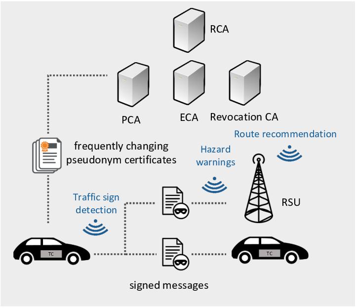
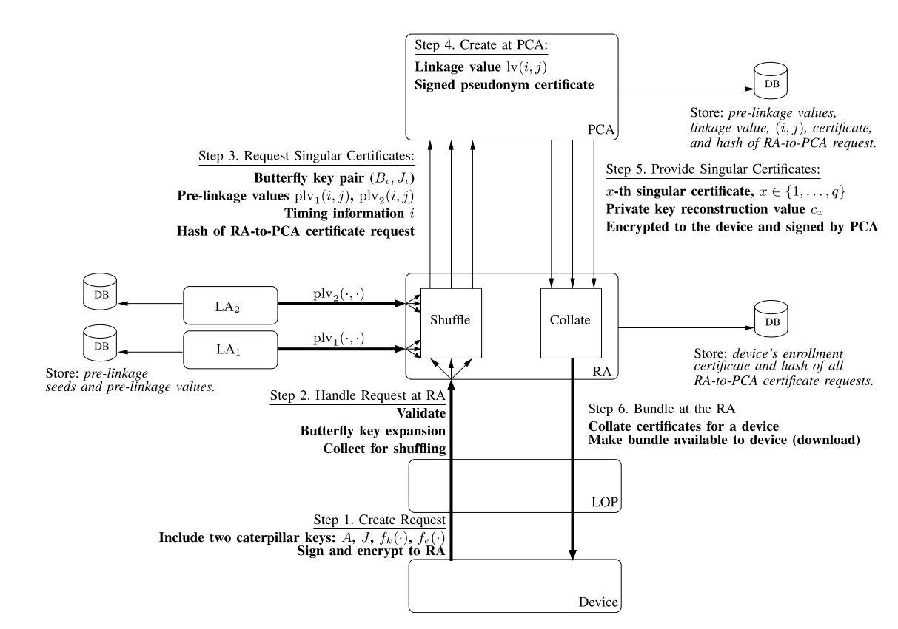
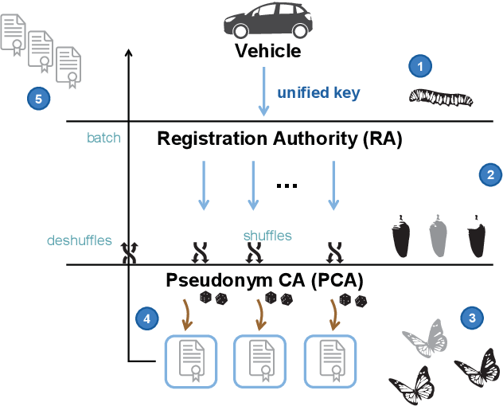
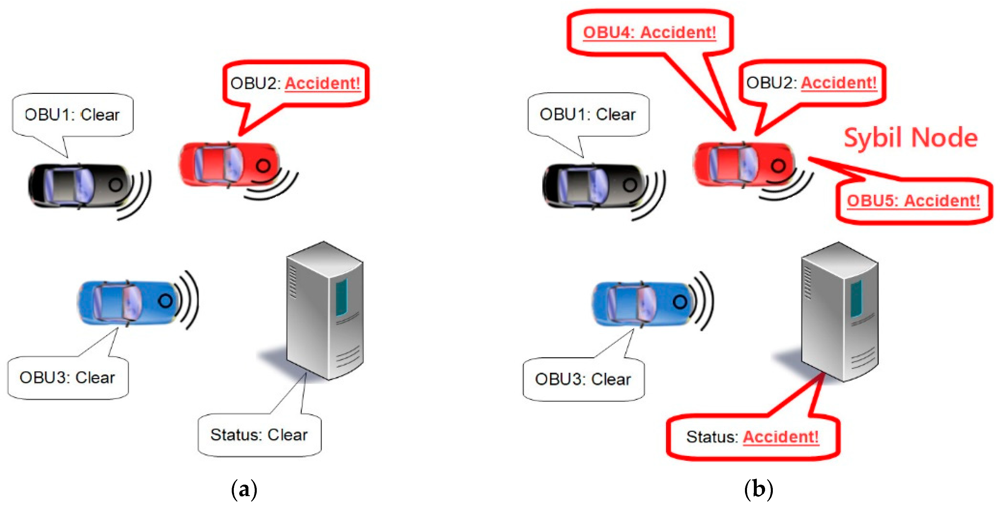
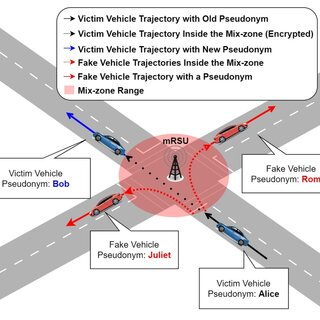

# Internet of Vehicles and V2X

## 3. How do mechanisms such as pseudonym certificates protect V2X security and privacy, and what are their limitations?

### Research Papers (RPs)

1. **[RP1]** B. Brecht, D. Therriault, A. Weimerskirch, W. Whyte, V. Kumar, T. Hehn, and R. Goudy, *"A Security Credential Management System for V2X Communications,"* IEEE Transactions on Intelligent Transportation Systems, vol. 19, no. 12, pp. 3850–3871, Dec. 2018.
2. **[RP2]** M. A. Simplício Jr., E. L. Cominetti, H. K. Patil, J. E. Ricardini, L. T. D. Ferraz, and M. V. M. Silva, *"Privacy-Preserving Method for Temporarily Linking/Revoking Pseudonym Certificates in VANETs,"* in Proc. 17th IEEE International Conference on Trust, Security and Privacy in Computing and Communications (TrustCom), 2018, pp. 1322–1329.
3. **[RP3]** F. Haidar, A. Kaiser, B. Lonc, and P. Urien, *"Risk Analysis on C-ITS Pseudonymity Aspects,"* in Proc. 10th IFIP International Conference on New Technologies, Mobility and Security (NTMS), 2019, pp. 1–5.
4. **[RP4]** Y. Sun, R. Lu, X. Lin, X. Shen, and J. Su, *"An Efficient Pseudonymous Authentication Scheme With Strong Privacy Preservation for Vehicular Communications,"* IEEE Transactions on Vehicular Technology, vol. 59, no. 7, pp. 3589–3603, Sept. 2010.
5. **[RP5]** T. Yoshizawa and B. Preneel, *"A New Approach To Pseudonym Certificate Management in V2X Communication,"* in Proc. IEEE Vehicular Networking Conference (VNC), 2023, pp. 25–32.

---

### 1. Introduction: The Vehicular Security-Privacy Dilemma

Connected vehicle environments rely on high-frequency, unencrypted broadcast telemetry beacons—Basic Safety Messages (BSMs) in the US and Cooperative Awareness Messages (CAMs) in Europe—transmitted at 10 Hz (every 100 ms) over dedicated 5.9 GHz wireless channels. These packets convey critical dynamic kinematic data, including high-precision GNSS coordinates, velocity, heading, longitudinal/lateral acceleration, and vehicle dimensions.

This operational environment introduces a fundamental engineering tradeoff:

* **The Authentication Imperative:** Automated decision-making modules, collision avoidance systems, and cooperative driving algorithms must verify that received telemetry originates from an authentic, certified vehicle and has not been altered or injected by an attacker. Because broadcast safety packets cannot afford the latency of interactive handshakes (like TLS), vehicles attach public-key digital signatures (typically ECDSA over NIST P-256 or Brainpool elliptic curves) and a digital certificate directly to their outgoing packets.
* **The Privacy Threat:** If a vehicle signs broadcasted telemetry with a static digital certificate, long-term hardware identity, or unchanging cryptographic key, any passive observer with a commercial radio receiver or roadside sniffer can record and correlate the transmissions. Because beacons broadcast exact physical locations 10 times a second, a static signature key acts as a wireless license plate, allowing adversaries to profile drivers, reconstruct historical routes, identify home/work addresses, and violate driver privacy.

**Pseudonym certificates** serve as the foundation of modern Vehicular Public Key Infrastructures (VPKIs). Instead of using one permanent certificate, a vehicle is provisioned with a large batch of temporary, short-lived digital certificates (pseudonyms) that contain no personally identifiable information. By periodically rotating which pseudonym it uses to sign messages, the system achieves **conditional anonymity**: benign vehicles remain unlinkable to roadside observers and other drivers, while authorized backend authorities retain the cryptographic ability to identify, trace, and revoke malicious or malfunctioning nodes.

*Figure 1: Overview of a PKI-based V2X security solution. Vehicles download batches of frequently changing pseudonym certificates from the Pseudonym CA (PCA) and use them to attach masked digital signatures to V2V and V2I safety messages (such as hazard warnings and traffic sign detection), ensuring message authenticity without exposing long-term vehicle identities.*

---

### 2. Trust Architectures and Pseudonym Issuance Frameworks

#### 2.1 Multi-Authority Separation of Duties (Anti-Insider Design)

A naive PKI where a single Certificate Authority (CA) knows the vehicle's permanent identity and issues all of its temporary pseudonyms creates a single point of privacy failure: an insider at the CA (or a government subpoena/hacker) could track every car in the country. To prevent internal PKI operators from becoming an omniscient tracking adversary, modern standards enforce strict **organizational and functional separation of duties** governed by an **honest-but-curious non-collusion model**:

* **North American SCMS (IEEE 1609.2 / 1609.2.1):** As defined by Brecht et al. [RP1], the Security Credential Management System (SCMS) splits the backend across independent authorities so that no single server holds enough information to map a physical vehicle to its pseudonym certificates:
  * **Enrollment CA (ECA):** Acts as the initial onboarding authority. It authenticates the vehicle's permanent hardware identity during factory manufacturing or bootstrapping and issues a single long-term enrollment credential (its "cryptographic passport"). The vehicle never uses this certificate to sign road messages; it only uses it to request temporary pseudonyms.
  * **Location Obscurer Proxy (LOP):** Operates as a network anonymizer (similar to a Tor/proxy relay), stripping IP addresses and location-revealing network metadata from the vehicle's requests before forwarding them to the backend servers.
  * **Registration Authority (RA):** Validates that a vehicle's batch request comes from a legitimate, non-revoked enrollment credential. However, the RA never sees the final pseudonym certificates—it shuffles requests from thousands of vehicles together to break timing correlations and forwards individual blinded requests to the Pseudonym CA.
  * **Pseudonym CA (PCA):** Generates and signs the actual pseudonym certificates, using compact *implicit certificates* (a space-saving format where the public key is mathematically reconstructed directly from the certificate data rather than carrying a separate CA signature). Crucially, the PCA receives requests blindly through the RA and encrypts the resulting certificate directly for the vehicle's On-Board Unit (OBU). Thus, the RA knows *who* asked for certificates, and the PCA knows *what* certificates were created, but neither knows both.
  * **Linkage Authorities ($LA_1$ and $LA_2$):** Two independent entities that generate cryptographic tags ("pre-linkage values", $plv_1$ and $plv_2$) embedded inside each certificate. If a car later misbehaves, these tags allow authorities to revoke all of that car's certificates at once. By splitting this job across two independent servers that XOR their outputs together ($lv = plv_1 \oplus plv_2$), neither LA can link a vehicle's certificates on its own.
  * *Trust Boundary:* Driver privacy is mathematically guaranteed unless at least two structurally independent organizations (such as the RA and PCA, or $LA_1$ and $LA_2$) actively collude.

*Figure 2: The SCMS Multi-Authority Pseudonym Issuance Pipeline (Brecht et al. [RP1]). The vehicle sends its request through the LOP to the RA (Steps 1–2). The RA combines the request with pre-linkage values ($plv_1, plv_2$) from $LA_1$ and $LA_2$ and shuffles requests across thousands of vehicles before forwarding them to the PCA (Step 3). The PCA generates the final linkage value ($lv$) and signs the pseudonym certificate (Step 4), encrypting the certificate and private key reconstruction value ($c_x$) directly for the vehicle (Steps 5–6) so the RA cannot read them.*

* **European C-ITS Architecture (ETSI TS 102 940 / TS 102 941):** As analyzed in Haidar et al. [RP3] and Yoshizawa & Preneel [RP5], the European standard follows a similar split: an **Enrolment Authority (EA)** manages long-term identities, while an **Authorization Authority (AA)** issues short-term **Authorization Tickets (ATs)**—the European term for pseudonym certificates. A Distribution Center (DC) publishes trust lists of valid authorities. Just like in the US, long-term enrollment credentials are never broadcast over the air; only short-lived ATs sign CAMs and Decentralized Environmental Notification Messages (DENMs).

#### 2.2 Scalable Batch Issuance: Butterfly Keys vs. Proxy Re-Signatures

Because vehicles frequently drive through rural or underground areas without cellular coverage, their OBUs must preload hundreds to thousands of pseudonym certificates at a time (e.g., a 1-to-3-year supply). However, having a vehicle generate 3,000 unique public/private key pairs and upload 3,000 public keys over a cellular connection is too slow and bandwidth-heavy. Two cryptographic mechanisms solve this scalability bottleneck:

1. **Butterfly Key Expansion (SCMS / ETSI):** Under Butterfly Key derivation [RP1], the vehicle does not upload thousands of public keys. Instead, it generates a single unified "seed" public key (called the *caterpillar key*) and sends it to the RA along with a deterministic mathematical expansion function.
   * **Step 1 (Expansion at the RA):** Using this single caterpillar seed, the RA runs the expansion function to deterministically generate thousands of intermediate public keys (called *cocoon keys*) on the vehicle's behalf and shuffles them with cocoon keys from other vehicles.
   * **Step 2 (Blinding at the PCA):** Because the RA knows which vehicle owns those cocoon keys, the PCA cannot simply sign them as-is (otherwise the RA could recognize them on the road). Therefore, for each cocoon key, the PCA generates a random secret offset (like rolling dice), adds it to the cocoon key to create the final *butterfly public key*, and embeds that final key into the pseudonym certificate.
   * **Step 3 (Reconstruction at the Vehicle):** The PCA encrypts both the new certificate and the secret offset into a package that only the vehicle can decrypt. The RA deshuffles and bundles the encrypted packages back to the vehicle. Upon decryption, the vehicle adds the PCA's secret offset and the expansion step to its original private seed key, allowing it to locally compute the exact private signing key that matches each new certificate. This enables requesting thousands of certificates in a single compact message while keeping the RA and PCA blind to each other.

*Figure 3: Intuition behind Butterfly Key Expansion. (1) The vehicle uploads a single unified "caterpillar" seed key to the RA; (2) the RA expands the seed into multiple "cocoon" keys and shuffles them across different vehicles; (3) the PCA adds random secret offsets (represented by the dice) to turn each cocoon into a unique "butterfly" certificate; (4–5) the RA deshuffles the encrypted responses and returns the certificate batch to the vehicle.*

2. **Proxy Re-Signatures (PASS Scheme):** Before Butterfly Keys became the industry standard, Sun et al. [RP4] proposed the PASS architecture, which offloads certificate management to local Roadside Units (RSUs). Instead of downloading thousands of new certificates from a cloud CA, a vehicle holds a base set of certificates signed by a central Trusted Authority (TA). When the vehicle enters a new geographic region managed by a local RSU, it requests a tiny, 175-byte **re-signature key** from that RSU. Using an advanced cryptographic operation called *bilinear pairings* (a mathematical framework that allows signatures from one authority to be transformed and verified under another authority's key) combined with a local random blinding factor, the vehicle's OBU locally converts its central TA certificates into valid RSU-signed certificates. The vehicle never has to reveal its pseudonyms to the RSU, and the RSU doesn't have to generate new certificates from scratch.

---

### 3. Revocation Paradigms and Credential Management

Revocation is essential for kicking hacked, faulty, or malicious vehicles out of the V2X network so other cars ignore their fake safety messages. However, revoking pseudonym certificates presents a massive scaling challenge: if a malicious vehicle holds 3,000 valid or future pseudonyms, putting all 3,000 certificate serial numbers onto a traditional Certificate Revocation List (CRL) would cause the CRL file size to explode, clogging wireless bandwidth and overflowing OBU memory.

#### 3.1 Active Revocation via Linkage Values and Hash Chains

To keep CRLs compact, modern systems embed a cryptographic puzzle inside every certificate belonging to the same vehicle. Instead of listing 3,000 serial numbers on a CRL, the authority publishes a single secret "seed" value that allows receiving vehicles to automatically link and block all 3,000 certificates at once:

* **Dual Hash-Chain Identity Construction (Sun et al. [RP4]):** A one-way hash chain is created by taking a secret starting seed and repeatedly hashing it ($Seed \to h(Seed) \to h(h(Seed)) \dots$). In the PASS scheme, the authority creates two hash chains for each vehicle—one running forward through time and one running backward—and combines (XORs) their outputs at each time slot $j$ to generate the vehicle's temporary pseudonym ID for that slot. If the vehicle needs to be revoked at time slot $j$, the authority simply publishes the current forward and backward hash values on the CRL. This takes only **48 bytes per revoked vehicle** ($O(1)$ constant size overhead) and allows every other car to compute all remaining future pseudonym IDs for that rogue vehicle without revealing any of its past trips.
* **SCMS Linkage Values (Brecht et al. [RP1]):** SCMS uses a similar forward hash-chain approach split across its two Linkage Authorities ($LA_1, LA_2$). For each time period $t$, both LAs hash their vehicle-specific secret seed forward to create a period seed, encrypt it to create a *pre-linkage value* ($plv_1, plv_2$), and have the PCA embed the XOR combination of both values (called the **Linkage Value**, $lv$) inside the vehicle's pseudonym certificate. Under normal driving, this $lv$ looks like random noise to other cars. However, if a vehicle is revoked starting at time period $t_s$, the authority publishes that vehicle's two raw seed values for period $t_s$ on the CRL. Any receiving car on the road can now take those two published seeds, run the exact same deterministic hash-and-XOR steps for all current and future time periods ($t \ge t_s$), and instantly recognize if the $lv$ inside an incoming safety message belongs to a revoked vehicle.
* **Retrospective Unlinkability (Backward Privacy):** Because cryptographic hash functions are strictly one-way (you can easily hash period $t_s$ forward to find $t_{s+1}$, but you cannot reverse the hash to find $t_{s-1}$), publishing a vehicle's revocation seeds at time $t_s$ only exposes its certificates from $t_s$ onward. Eavesdroppers cannot use the CRL to go backward and trace the trips the driver took *before* being revoked.

#### 3.2 Passive Revocation: Issue First Activate Later (IFAL)

Because broadcasting CRLs to millions of cars over the air is still resource-intensive, the European C-ITS framework (ETSI TS 102 941) and the **Issue First Activate Later (IFAL)** policy propose an alternative called **passive revocation**, which eliminates over-the-air CRLs entirely:

* Under IFAL [RP5], a vehicle is preloaded at the factory with up to 5 years' worth of pseudonym certificates (Authorization Tickets), but these certificates are **dormant (locked)** inside the vehicle's hardware module.
* Time is divided into 90-day epochs. To unlock and use the certificates for the upcoming 90-day window, the vehicle must connect to the authority and download a tiny **epoch activation key**, which is sent encrypted under a permanent secret transport key shared between the car and the authority.
* If a vehicle is reported as compromised or malicious, the backend authority simply stops sending it activation keys for future epochs. Once the current 90-day window expires, the rogue vehicle runs out of usable certificates and is automatically silenced without any other car needing to download a CRL.

#### 3.3 Dynamic Activation: OAuth 2.0 and Authenticated Encryption

While IFAL avoids CRLs, waiting 90 days for a malicious car's certificates to expire is dangerously slow, and relying on a single permanent transport key is a security risk. To fix this, Yoshizawa and Preneel [RP5] redesigned passive activation by adapting the web's **OAuth 2.0 authorization framework (RFC 6749)** and modern **Authenticated Encryption (AES-GCM-SIV)**:

* **Automotive OAuth Workflow:** Instead of a web login popup, unlocking the car doors and starting the ignition acts as the driver's physical consent trigger (acting as the OAuth *Resource Owner*). This triggers the vehicle's OBU (the *Client*) to request a short-lived daily activation token from the Authorization Authority (the *Authorization Server*). The vehicle's tamper-proof Hardware Security Module (HSM—a dedicated security chip that stores private keys) acts as the *Resource Server*: it refuses to generate digital signatures for safety messages unless the OBU presents a valid, fresh activation token from the authority.
* **Key Ratcheting for Forward & Backward Secrecy:** Instead of encrypting activation codes with a permanent, static transport key like IFAL, the HSM and the authority use a dynamic key-derivation key that **ratchets forward** via a one-way hash after every handshake. For each session, it derives temporary encryption and authentication keys and then overwrites the old state. Even if an attacker extracts the current key from the car, they cannot decrypt past sessions (forward secrecy) or predict future keys once the ratchet advances (backward secrecy), while shrinking the passive revocation window from 90 days down to **24 hours**.

---

### 4. Technical Limitations, Vulnerabilities, and Tradeoffs

Despite their sophisticated design, pseudonym certificate mechanisms suffer from critical cryptographic, operational, and physical limitations across all five surveyed papers.

| Paper / Mechanism | Protection Focus | Primary Architectural Limitation Exposed | Operational Tradeoff |
| --- | --- | --- | --- |
| **Brecht et al. [RP1] (SCMS)** | Multi-authority separation; Butterfly keys; Linkage Values. | CRL grows linearly with the number of revoked vehicles; OBUs must provision storage for at least 10,000 revoked entries. | High organizational complexity to run split authorities; ECDSA is vulnerable to future quantum computers. |
| **Simplício et al. [RP2]** | Domain-separated security strings; Tree-based Linkage Hooks. | Multi-key birthday attacks weaken 128-bit linkage keys down to 108 bits of security (below NIST's 112-bit minimum). | Adding a 40-bit tree identifier per revoked entry slightly increases CRL packet size. |
| **Haidar et al. [RP3] (ETSI TVRA)** | ETSI Threat, Vulnerability, and Risk Analysis (TVRA); Pool rules. | **Pseudonym Pool Exhaustion (DoS)** and **Sybil attacks** when multiple certificates are valid at the same time. | Certificates only prove *who* signed a message, not whether the GPS/sensor data inside is physically true. |
| **Sun et al. [RP4] (PASS)** | Dual hash-chain $O(1)$ revocation; RSU proxy re-signatures. | Heavy bilinear pairing math (~14.7 ms per verification) causes **40–50% packet drops** in dense traffic simulations. | Prevents RSU tracking and shrinks CRLs, but requires expensive cryptographic hardware accelerators. |
| **Yoshizawa & Preneel [RP5]** | Daily OAuth 2.0 activation; Ratcheting key security. | **Certificate Waste Paradox:** 95.2% of time-slotted certificates expire unused; fragile cellular/SMS activation links. | Baseline IFAL leaves a dangerous **90-day window** where revoked cars can still broadcast fake messages. |

#### 4.1 Cryptographic Aging and Multi-Key Birthday Attacks

Simplício et al. [RP2] discovered a subtle mathematical flaw in how SCMS generates its Linkage Values: because thousands of certificates across thousands of cars are generated using the same block-cipher structure, the system is vulnerable to a **multi-key birthday attack**:

* **Pre-Linkage Collision Attack:** In cryptography, breaking a single 128-bit key by brute force takes $2^{128}$ operations. However, when an attacker isn't targeting one specific key, but simply wants to find a collision matching *any* one of a huge collection of ciphertexts encrypted under different keys, the birthday paradox applies: the more ciphertexts the attacker collects on the road, the fewer brute-force guesses they need. Because SCMS Linkage Authorities encrypt a predictable, fixed string under 128-bit linkage seeds, an attacker who records pre-linkage values from just **20,000 vehicles over one year** (roughly $2^{20}$ values) only needs $2^{108}$ offline operations ($128 - 20 = 108$) to crack a linkage seed. This drops the effective security to **108 bits**, violating the NIST minimum standard of 112-bit security.
* **Precomputed Hash-Chain Reversal:** Similarly, an attacker can build massive precomputed lookup tables ("rainbow tables") of hash chains ahead of time. When a vehicle's seed is later published on a CRL, the attacker can look it up in their table to reverse the hash chain and uncover the vehicle's past seeds, breaking backward privacy.
* **Mitigation via Security Strings and Linkage Hooks:** Simplício et al. fixed both flaws by injecting a unique 96-bit **security string** (containing the authority ID, a random tree ID, the time period, and the hash step counter) into every single hash and encryption step. Because every step now uses a slightly different input domain, precomputed tables and multi-key collisions become useless, restoring full 128-bit security. They also organized a vehicle's seeds into a binary tree structure per time window using intermediate **Linkage Hooks**: this allows police or authorities to temporarily link or revoke a car for a short time window (e.g., investigating a hit-and-run) without exposing its entire multi-year certificate chain.

#### 4.2 The Certificate Waste Paradox

In schemes that assign strict, sequential time slots to certificates—such as IFAL [RP5] (where each certificate is valid for a specific 12-minute slot) or SCMS profiles with 5-minute single-use tickets [RP1]—certificates expire when their clock window passes, even if the car is parked in a garage.

* Real-world transportation statistics show that European drivers drive an average of **46.1 minutes per day** (and 55.2 minutes in the US), meaning cars sit parked over 96% of the time.
* Because sequential certificates expire while the car is turned off, **95.2% of all generated pseudonym certificates are thrown away without ever signing a single message**.
* Scaled across the European Union's 277.8 million vehicles, backend PKI servers must generate, encrypt, transmit, and store **~13.27 trillion useless certificates (~1.85 Petabytes of wasted cryptographic data) every single year**, creating massive, unnecessary computational and energy overhead.

#### 4.3 The Passive Revocation Eviction Gap and Activation Vulnerabilities

While passive revocation (IFAL) avoids broadcasting CRLs, Yoshizawa and Preneel [RP5] highlight three severe operational flaws in its baseline design:

* **The 90-Day Revocation Gap:** Because IFAL distributes activation codes in 90-day batches, the authority can only punish a malicious vehicle by refusing to send the *next* quarter's code. If a vehicle is hacked on Day 1 of a new epoch, there is no mechanism to deactivate its current batch—meaning **a compromised vehicle can continue broadcasting authenticated fake safety messages for up to 90 days**.
* **Static Transport Keys:** IFAL uses a single, permanent symmetric key installed at the factory to encrypt all activation codes over the car's lifetime. If an attacker extracts this single key, they can decrypt every past and future activation batch, permanently destroying both forward and backward secrecy.
* **Broken SMS / eCall Assumptions:** IFAL suggested sending activation codes via SMS using the cellular modem required by the EU **eCall directive** (Europe's automated emergency crash-notification system). However, EU law strictly mandates that eCall modems remain **disconnected and dormant** from cellular networks during normal driving to prevent cellular tracking, only powering on when airbags deploy in a crash. Thus, the modem cannot receive background SMS codes—and even if it could, NIST (SP 800-63B) explicitly bans SMS for security authentication because SMS messages are easily intercepted and spoofed.

#### 4.4 Sybil Exploitation vs. Pseudonym Pool Exhaustion (The Pool Paradox)

To avoid the Certificate Waste Paradox and allow cars to switch pseudonyms flexibly while offline, US and European industry consortiums (CAMP and C2C-CC) allow a vehicle to hold a **concurrent pool** of multiple certificates (e.g., 20 to 100 certificates) that are all valid for the same week. Haidar et al. [RP3] showed through a formal ETSI Threat, Vulnerability, and Risk Analysis (TVRA) that concurrent pools create a catch-22 with two devastating attacks:

* **Sybil Attacks (Too Many Active IDs):** Because a vehicle holds 20+ certificates that are all valid at the exact same moment, a malicious or hacked OBU can sign 20 different safety messages using all 20 certificates simultaneously. To surrounding cars and smart traffic lights, it looks like 20 real vehicles are on the road. An attacker can use this to create "ghost traffic jams" that trick navigation systems into rerouting traffic, or fake an approaching platoon of emergency vehicles to force green traffic lights.
* **Pseudonym Pool Exhaustion (Privacy Denial-of-Service):** To prevent two nearby cars from accidentally using the same temporary ID, many OBUs immediately burn their current pseudonym and switch to a fresh one if they hear another broadcast using their ID. An attacker can exploit this by simply recording a victim car's broadcast and immediately re-transmitting that same ID back at the victim. The victim's OBU thinks a collision happened and switches to its next certificate. By repeating this spoofed echo in a loop, the attacker forces the victim to burn through its entire week's pool of certificates in seconds—either shutting down its V2X safety system completely or forcing it to reuse a single certificate and lose all privacy.
* **Pseudonym Change Strategy (PCS) Inhibition:** Conversely, an attacker can manipulate surrounding traffic conditions (since some cars only change pseudonyms when surrounded by other cars) to prevent a target vehicle's switching algorithm from triggering, trapping the driver on a single trackable certificate.

*Figure 4: Sybil Attack exploiting a concurrent pseudonym pool. (a) When restricted to a single active certificate (OBU2), a single false "Accident!" report from the red vehicle is outvoted by honest vehicles (OBU1 and OBU3 reporting "Clear"), so the roadside server maintains a "Clear" status. (b) By signing false messages with three valid pseudonyms simultaneously (OBU2, OBU4, and OBU5), the malicious Sybil node manufactures a fake majority and tricks the roadside infrastructure into declaring a phantom accident.*

#### 4.5 Cryptographic Verification Latency vs. Automotive Deadlines

Automated collision avoidance systems have strict real-time deadlines: an OBU must verify incoming safety messages within **10 to 20 ms** to react to sudden hard braking.

* In pairing-based schemes like PASS [RP4], checking a single unfamiliar certificate requires three bilinear pairing operations and two elliptic-curve point multiplications, which takes roughly **14.7 ms of CPU time per certificate**.
* On a busy highway where 50 to 100 cars are broadcasting 10 times a second, the OBU's incoming message queue overflows immediately, causing **40% to 50% of safety packets to be dropped** before they can be verified.
* Because of this severe latency bottleneck, modern standards (IEEE 1609.2 and ETSI) completely rejected bilinear pairings and standardized on lightweight **ECDSA elliptic-curve signatures**, which dedicated hardware security chips can verify in a fraction of a millisecond.

#### 4.6 Syntactic Anonymity vs. Semantic Kinematic Tracking

Perhaps the most fundamental limitation of pseudonym certificates is that they only provide **syntactic privacy** (changing the cryptographic ID and digital signature in the packet header) while providing **zero semantic privacy** over the physical driving data inside the packet:

* Every 100 ms (10 Hz), a vehicle's BSM/CAM broadcasts its exact GPS coordinates, speed, and heading in plaintext. Even if a car switches from $Cert_A$ to $Cert_B$ at 12:00:00.000, its physical position at 12:00:00.100 is only a few meters ahead along the exact same velocity vector.
* Using standard physics-based tracking algorithms (such as **Kalman filters** or multi-hypothesis Bayesian trackers), an eavesdropper can trivially predict where the car will be 100 ms later and link $Cert_B$ directly to $Cert_A$, reconstructing the driver's entire route as if they never changed certificates at all [RP1]. Furthermore, advanced radio receivers can fingerprint the unique hardware imperfections of a car's physical wireless transmitter (RF fingerprinting), bypassing cryptography entirely.
* Therefore, changing a certificate in isolation while cruising down a highway is useless. True location privacy requires combining certificate rotation with physical **Pseudonym Change Strategies (PCS)**—such as **Mix-Zones** (where an intersection RSU creates an encrypted zone or injects decoy trajectories while multiple cars turn and switch pseudonyms simultaneously) or **Silent Periods** (turning off radio broadcasts for a few seconds while changing lanes and rotating certificates so Kalman filters lose the trail)—which in turn creates a dangerous blind spot for collision avoidance during the silent window.

*Figure 5: Overcoming semantic trajectory tracking using an intersection Mix-Zone. A vehicle enters the intersection under its old pseudonym ("Alice"). Inside the shaded Mix-Zone range managed by a mix-RSU (mRSU), beacons are encrypted and decoy/fake trajectories ("Romeo" and "Juliet") are injected along intersecting roads. When the vehicle exits under its new pseudonym ("Bob"), an external tracker cannot tell whether "Alice" became "Bob", "Romeo", or "Juliet".*

---

### 5. Concluding Synthesis: Answering Question 3 Directly

Pseudonym certificates resolve the core tension between V2X security and driver privacy by providing **conditional anonymity**: vehicles sign broadcast safety packets using rotating, short-lived digital certificates rather than permanent IDs. This prevents roadside observers and other drivers from tracking a vehicle's daily routes while preserving the ability of backend authorities to link and revoke malicious nodes. To protect against insider abuse, modern VPKIs enforce **multi-authority separation of duties** (splitting identity verification, certificate signing, and linkage tag generation across independent servers that cannot link a vehicle without colluding) and use **Butterfly Key expansion** to provision thousands of certificates from a single compact request.

However, these mechanisms carry substantial architectural and operational limitations:
1. **Revocation vs. Bandwidth Tradeoffs:** Active revocation via hash-chain Linkage Values requires care to avoid multi-key birthday attacks and forces vehicles to download growing CRLs, whereas passive revocation (IFAL) eliminates CRLs at the cost of leaving a dangerous **90-day window** before a rogue vehicle's active certificates expire.
2. **The Waste vs. Sybil Dilemma:** Issuing certificates for rigid sequential time slots causes **95.2% of certificates to expire unused** while cars are parked (~1.85 PB of annual waste in the EU), but allowing multiple certificates to be valid concurrently enables **Sybil "ghost vehicle" attacks** and **Pseudonym Pool Exhaustion (DoS)**.
3. **Cryptographic vs. Physical Reality:** Finally, pseudonym certificates only provide **syntactic privacy** and **cryptographic authenticity**. They cannot stop an attacker from linking a vehicle's trajectory using physical Kalman filters over 10 Hz GPS broadcasts, nor can they guarantee that the sensor data inside an authenticated message is physically true—requiring VPKIs to be paired with physical mix-zone switching strategies and onboard Misbehavior Detection Systems.